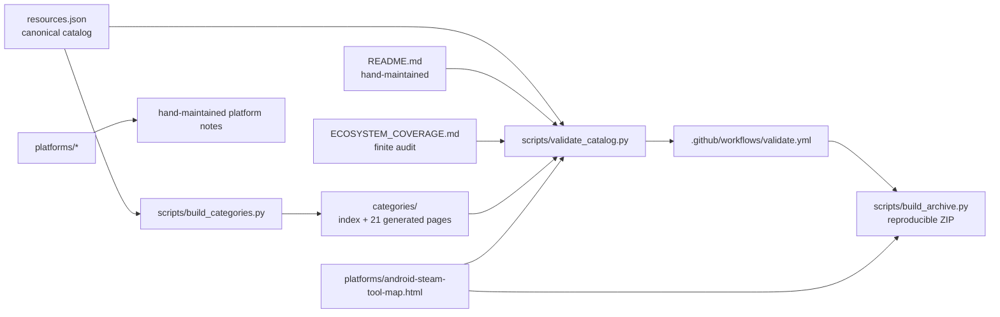

---
Children:
  - "[[Catalog Data and Schema]]"
  - "[[Human-Facing Navigation]]"
  - "[[Generated Category Pages]]"
  - "[[Platform Notes and Tool Map]]"
  - "[[Coverage Audit]]"
  - "[[Automation Pipeline]]"
  - "[[Governance and Contribution Flow]]"
  - "[[Integration Boundaries]]"
  - "[[Using K-Plex]]"
---
# Repository Overview

This is a **separate Obsidian vault** mapping the local project at `/home/user/game-modding-research-index`. It describes the repository; it does not copy its source files or catalog records.

## What the repository is

A curated, **link-only game-modding research index**, not a source-code monorepo. The current catalog has **384 records across 21 categories** and `last_reviewed: 2026-10-11`. This vault represents each category as a grouped note and deliberately does not create 384 individual resource notes.

## Architecture and data flow

- **Canonical data:** `resources.json` defines the catalog schema and records.
- **Generated view:** `scripts/build_categories.py` turns the canonical JSON into the category index and 21 alphabetized category pages.
- **Grouped category nodes:** [[Generated Category Pages]] is the parent of 21 K-Plex notes, one per catalog category. Each reports the number of records and its generated page path.
- **Hand-maintained docs:** the main README, coverage audit, platform notes, and Android/Steam HTML map add navigation or bounded analysis; they are not generated from the catalog.
- **Quality and distribution:** the validator checks catalog/document consistency and local map links/IDs; GitHub Actions runs it and then builds a reproducible ZIP that includes the HTML map.

## Repository landmarks

| Area | Role |
|---|---|
| `resources.json` | Canonical link records and category assignments |
| `categories/` | Generated browse index and one page per category |
| `README.md` | Human-facing project overview and curated links |
| `platforms/` | Hand-maintained technical notes and analysis map |
| `ECOSYSTEM_COVERAGE.md` | Finite, disposition-tracked coverage audit |
| `scripts/` | Category generation, validation, and archive building |
| `.github/workflows/validate.yml` | CI entry point |
| `AGENTS.md`, `CONTRIBUTING.md` | Working and contribution guidance |

## Map nodes

The connected notes are listed under `Children` in this note. Open [[Generated Category Pages]] to see the 21 category group nodes. See [[Using K-Plex]] to open the vault and [[Integration Boundaries]] for the updated archive/validation behavior.
